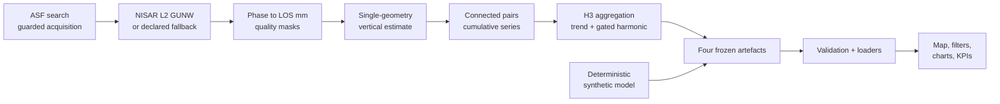

# CONTEXT.md — project context

*Three Cities, One Pump* compares aquifer-related ground motion in Mexico City, Jakarta, and Málaga.
The product is an interactive explorer, but the scientific work happens offline: SAR processing emits
small, versioned artefacts and the application renders them without re-deriving geospatial quantities.

This is the broad-strokes orientation document. Derivations, operator procedures, and field-level
contracts live in the focused guides linked below. Code and tests prevail when prose disagrees.

## 1. Purpose and evidence boundary

The product thesis is that differences in **interbed compressibility** help explain why Mexico City's
lacustrine clay compacts mostly inelastically, Málaga's karst system is comparatively elastic, and
Jakarta sits between those extremes. A shared map scale should make that contrast visible without
turning a weak signal into a confident claim.

Current repository evidence is deliberately limited:

- Contract **v1.1**, revision 2, fingerprint `ed92be80…`, is implemented in
  `src/domain/contracts.py` and described by `docs/data-contract-v1.md`.
- Three contract-conformant artefact sets exist under `data/processed/`.
- **Every committed case value is synthetic** (`product: "mock"`). It demonstrates schema,
  determinism, visualisation, and failure behaviour—not measured subsidence.
- The real NISAR GUNW path is implemented and tested with synthetic HDF5 fixtures. No downloaded
  granule has produced a published artefact, and no result has been validated against GNSS.
- The application exists and runs: `app.py` is a Streamlit shell over the committed mock, and the
  backend it may bind to (`src/data/loaders.py`, `ui_bridge.py`, `validation.py`) is tracked. The
  standalone `examples/reference_loader.py` is a dependency-free reference for that same API, not a
  second implementation to copy over it.

Availability, source selection, and unresolved merge questions are recorded in
`docs/data-source-decision.md` and `docs/decisions.md`, not as branch snapshots here.

## 2. Non-negotiable rules

1. **The app never computes science.** Colour uses stored `velocity_mm_yr`; height uses stored
   `delta_change`; charts and KPIs read stored series and statistics.
2. **Nodata is absent, never zero.** Invalid, low-coherence, or incomplete cells are omitted. A real
   zero remains a measurement. Never `fillna(0)` at the presentation boundary.
3. **Mock data labels itself.** `product`, provenance, limitations, and the UI badge must preserve
   the synthetic/real distinction through every layer.
4. **Fail closed where implemented.** Missing layers, incompatible geometry, disconnected stacks,
   invalid artefacts, and empty validation sets are errors, not invitations to invent defaults. A
   known exception is disclosed below: `process_case` can succeed when its external gate cannot run,
   so CI and operators must run that gate independently.
5. **Trace every number.** A shared `provenance_id` connects grid rows, series, context features, and
   the method recorded in `meta.json`.
6. **Publish only what the observation window identifies.** A fitted seasonal coefficient is not
   automatically a publishable seasonal measurement.

## 3. Architecture



The mock and real paths share artefact writers and validators. Replacing mock data with a valid real
artefact tree is therefore a **data replacement, not an application rewrite**. Neither path downloads
or processes NASA data on application startup.

The main module boundaries are:

| Concern | Owner |
|---|---|
| Product scope, setup, team workflow | `README.md`, `flujo_trabajo_y_responsabilidades.md` |
| Case parameters and analysis extents | `config/study_cases.yaml`, `config/aoi/` |
| Search, download guards, HDF5 reader | `pipeline/ingest/` |
| Physical transforms, fitting, aggregation | `pipeline/science/transforms.py`, `pipeline/process_case.py` |
| Deterministic synthetic path and shared writers | `pipeline/generate_mock.py`, `pipeline/mock/` |
| Schema, profiles, invariants, validators | `src/domain/contracts.py` |
| Consumer behaviour | `examples/reference_loader.py`, `docs/handoff-mock.md` |
| Application composition and interaction | frontend/backend roles; never the science modules |

## 4. Science in brief

A NISAR GUNW interferogram supplies unwrapped phase and coherence for an acquisition pair. The
pipeline converts phase to line-of-sight displacement using the wavelength and a **declared sign
convention**, masks invalid or low-coherence samples, and estimates vertical displacement from one
look geometry.

That inversion is underdetermined: one line-of-sight measurement cannot recover vertical, east, and
north motion independently. The current path assumes negligible north motion, uses any supplied
horizontal model, refuses mixed-geometry stacks, and records its assumptions in provenance. The sign
and heading conventions still require external validation before real values may be presented as
measurements.

Connected pairs form cumulative displacement relative to the first epoch and a configured reference
point. Values are aggregated into H3 resolution-9 cells, then fitted per cell:

- `delta_change` is cumulative displacement in **mm** over the published window.
- `velocity_mm_yr` is the fitted trend in **mm/yr**, not `delta_change` relabelled.
- The seasonal harmonic is centred in the synthetic model so a partial seasonal cycle does not leak
  into endpoint change.
- Span and design-conditioning gates decide whether a seasonal amplitude is identifiable. Contract
  v1.1 publishes the seasonal amplitude and regime fields; v1.0 did not. A stack too short to fit a
  harmonic publishes `seasonal_amp_mm = 0` ("not fitted"), `ratio_R = null` and
  `regime = "transitional"`.
- A near-zero median requires `stats.detection_limit_mm_yr`; Málaga is the deliberate negative
  control, not an empty result to hide.

See `docs/science-guide.md` for derivations, worked examples, coherence correction, error sources,
identifiability, detection limits, and H3 semantics. See `docs/nisar-gunw-layout.md` for the granule
layout and the facts that still must be checked against the first real file.

## 5. The data boundary

Each case under `data/processed/{case}/` contains exactly four public artefacts:

| Artefact | Purpose | Important distinction |
|---|---|---|
| `nisar_grid.parquet` | One row per published H3 cell | `delta_change` in mm; `velocity_mm_yr` in mm/yr |
| `timeseries.csv` | Cumulative displacement by date | `cell_id == "aoi"` is the aggregate; per-cell rows are opt-in |
| `context_layers.geojson` | Land use, infrastructure, water, and analysis extent | Water can be context without being a displacement cell |
| `meta.json` | Dates, thresholds, provenance, statistics, limitations, null policy | Carries the mock badge and mandatory null-result bound |

The schema, enums, per-product thresholds, and validation rules are owned by
`src/domain/contracts.py`; `docs/data-contract-v1.md` is their normative prose companion. Do not copy
those tables into components or this overview.

For map bindings, loader behaviour, filtering, and UI honesty requirements, read
`docs/handoff-mock.md`; its implementation is `src/data/loaders.py`, which is authoritative. The
later PMTiles design in `docs/route-contract.md` is post-MVP and does not replace the four-artefact
interface.

## 6. Processing paths and known limits

| Path | Input | Evidence today | Output |
|---|---|---|---|
| Mock | Case configuration, fixed seed, synthetic spatial/temporal model | Deterministic regeneration and contract/plausibility tests | Three committed mock cases |
| Real | A connected, single-geometry NISAR L2 GUNW stack | Synthetic-fixture integration tests only | Same four-artefact schema after validation |

The real path already guards product identity, polarisation, stack compatibility, required layers,
geometry, reference connectivity, minimum fit length, output overwrite, and artefact validity. Its
logical stages include atmospheric/orbit/DEM corrections and richer context joins that are **not**
fully implemented; existence of a stage name is not evidence that correction ran.

Important unresolved items include:

- ~~the granule-identity parsers disagree about which filename token is the track~~ **resolved
  2026-11-14 (O-06)**: both parsers read track = token 5 and frame = token 7, and a regression
  pins it (`tests/test_parser_agreement.py`);
- ~~the CLI's away-positive LOS label conflicts with the projection's sign~~ **closed 2026-11-15
  (O-08) by renaming**: the default label is `toward-sensor`, matching `u_up = cosθ > 0`; the
  factor is unchanged at −1.0, so no published number moved. What remains open is GNSS
  *validation* of the convention, not the naming;
- urban GUNW coverage and the exact real-file layout remain unverified;
- atmospheric, orbital, DEM, and unwrapping errors are not all corrected;
- a short window cannot support confident seasonal or elastic/inelastic claims;
- the declared Málaga detection bound is a recorded mock decision, not a bound estimated from real
  residuals;
- `process_case` can exit 0 when the external artefact gate could not run, so its exit status alone
  is not proof of file-level validation.

`docs/pipeline-internals.md` preserves the parser discrepancy, reader fallbacks, actual processing
order, refusal taxonomy, writer parity, and contract-implementation caveats. `docs/mock-model.md`
documents the synthetic generator. The first real run must follow `docs/first-granule-runbook.md`.

## 7. Verification

Run commands from the repository root through the environment wrapper:

```bash
./scripts/check_phase_a.sh
./scripts/preflight.sh
./scripts/python.sh -m pytest tests
```

The first command is the artefact-facing handoff gate. `preflight.sh` adds the broader submission
checks, including clean-clone reproduction, figure regeneration, and presenter-number checks. The
full pytest suite is the thorough regression check. A remembered test count or a copied table of mock
medians is not evidence; exit status and regenerated output are.

`docs/verification.md` explains what each gate proves and what it does not. The numerical guards
re-derive documented claims from code, configuration, or artefacts rather than treating prose as an
independent source of truth.

## 8. Documentation map

| Need | Read |
|---|---|
| Project scope, setup, roles, submission state | `README.md`, `flujo_trabajo_y_responsabilidades.md` |
| Scientific derivations and spatial/time semantics | `docs/science-guide.md` |
| Acquisition and processing internals | `docs/pipeline-internals.md` |
| Synthetic generator mechanics | `docs/mock-model.md`, `config/study_cases.yaml` |
| Contract fields and invariants | `docs/data-contract-v1.md`, `src/domain/contracts.py` |
| Real-file structure and correction protocol | `docs/nisar-gunw-layout.md` |
| First real-data run | `docs/first-granule-runbook.md` |
| UI/loader handoff | `docs/handoff-mock.md`, `examples/reference_loader.py` |
| Decisions, evidence, and open questions | `docs/decisions.md` |
| Verification gates | `docs/verification.md`, `docs/submission-checklist.md` |
| Demo and narration | `docs/demo-fallback.md`, `docs/video-script.md` |

## 9. Keeping this context accurate

- Update code, tests, and the owning focused document together; do not expand this overview to track
  every field, command flag, test file, branch HEAD, or generated number.
- Treat availability probes and implementation status as dated evidence. Re-run the relevant command
  before repeating them.
- Record design choices and reversal conditions in `docs/decisions.md`; record open evidence gaps as
  open questions rather than silently resolving them in prose.
- Add new durable detail to the appropriate focused guide and link it here only when it changes the
  project's architecture, evidence boundary, or reading path.
