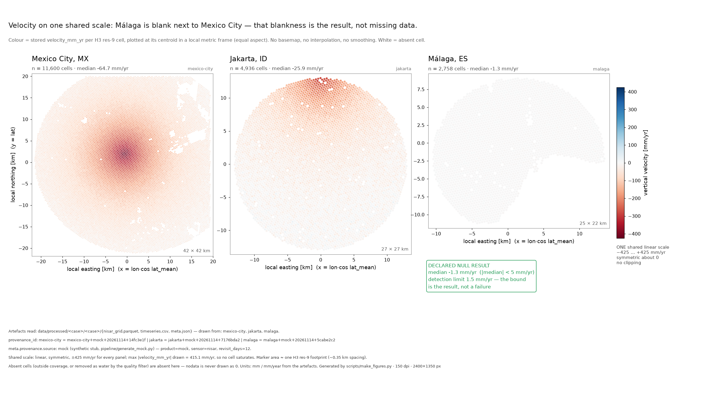
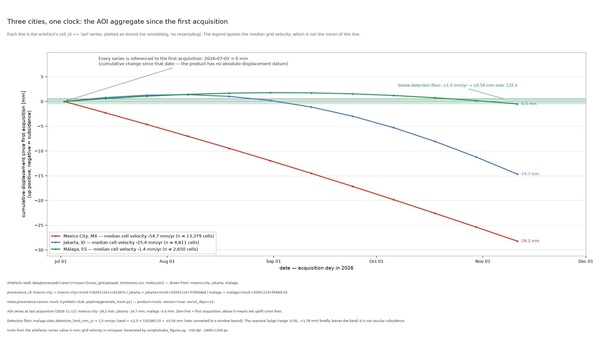

# Three Cities, One Pump

**An interactive SAR subsidence & land-change explorer — NISAR + Sentinel-1.**

NASA Space Apps Challenge 2026 — *Dancing with the SARs*.
**Deliverable: a deployed web application**, not a report.

| | |
|---|---|
| Demo | *not deployed yet* — the app shell is the frontend role's next task |
| Repository | `github.com/neoyuls/SAR_NASA`, branch **`yuls`** (this is the branch with the artefacts; `main` lags) |
| Video | script ready in [`docs/video-script.md`](docs/video-script.md); recording pending |
| Team | **yuls** SAR science, GIS, product · **pozo** geospatial backend, deployment · **fradiaz** frontend, interaction |
| Challenge | NASA Space Apps 2026 — *Dancing with the SARs* |

> **What works today (2026-11-14, ~hour 40 of 48).** Contract v1.0 frozen and enforced by tests ·
> three contract-conformant **mock** artefact sets · the whole offline pipeline, rehearsed on
> synthetic granules · `./scripts/check_phase_a.sh` → PASS, and a fresh clone of this branch runs
> the full suite green.
>
> **What does not exist yet:** any UI, any run on a real granule, any deployed URL.
> **Every number in `data/processed/` is synthetic** — `product: "mock"`, and every artefact says so
> in its own `provenance` and `limitations`.
>
> **Language.** This README is the entry point (English). The operative role/workflow document
> [`flujo_trabajo_y_responsabilidades.md`](flujo_trabajo_y_responsabilidades.md) is in Spanish and
> prevails on anything about responsibilities, branches and phases; the data contract itself lives
> in [`docs/data-contract-v1.md`](docs/data-contract-v1.md) and `src/domain/contracts.py`.

---

## 1. What it is

A web app that lets anyone scrub through time, watch three cities sink, and understand why one of
them barely moves at all.

| Capability | What the user does |
|---|---|
| **Time scrub** | Drag a date slider; charts and KPIs update across the 12 dates — the **map** shows the first/last snapshot only (the contract carries `val_t1`/`val_t2`, not a per-date grid) |
| **Click to interrogate** | Click a cell → displacement series, trend, quality (needs `--per-cell-series` artefacts; the committed set carries only the AOI aggregate) |
| **Compare mode** | Three cities on **one shared colour scale** |
| **Filter** | Coherence, land use, risk level, critical-velocity threshold |
| **Evidence** | Every layer shows its unit, source, date range and revisit interval |
| **Learn** | An educational tab explains NISAR, what SAR measures, and what it cannot |

### The thesis the app must make visible

Subsidence is set by **interbed compressibility**, not by how much water is pumped.

| | **Mexico City** | **Jakarta** | **Málaga** |
|---|---|---|---|
| Aquifer | Lacustrine clay, closed basin | Deltaic soft clay, coastal | Thin detrital cover, confined karst |
| Regime | Mostly **inelastic** | Mixed | Mostly **elastic** |
| Subsidence | **−45 cm/yr** (published) | ~5 cm/yr avg; >1 m cumulative | mm–cm/yr |
| Failure mode | Land loss, faulting, drainage inversion | Inundation, capital relocation | Salinization, reservoir depletion |

> **The product insight:** on a shared legend, Málaga renders nearly flat. **That blankness is the
> finding** — and it is a data decision (one scale, honest units, published detection limit), not a
> paragraph of prose.



*The three cases on one symmetric ±425 mm/yr scale, drawn straight from the **synthetic mock**
artefacts (`product: mock`) —
Mexico City's bowl, Jakarta's coastal edge, and Málaga essentially blank. Generated by
`scripts/make_figures.py`; the numbers behind it are pinned by `tests/test_handoff_numbers.py`.*

---

### Verify in 15 seconds

```bash
./scripts/check_phase_a.sh     # ~15 s → PHASE A/B: PASS · 3 cases · 0 problems · 1.61 MB / 15 MB
```

| case | cells | window | median mm/yr | product | source |
|---|---:|---|---:|---|---|
| `mexico-city` | 13,379 | 2026-07-02 → 2026-11-11 | −54.7 | mock | synthetic |
| `jakarta` | 4,811 | same window | −25.4 | mock | synthetic |
| `malaga` | 2,650 | same window | −1.4 | mock | synthetic |

The full suite (`./scripts/python.sh -m pytest tests`, ~2.5 min) is the thorough check; the gate is
what a judge should run first. `scripts/demo_numbers.py` prints every number a presenter may say,
derived from the artefacts rather than typed into a slide.

---

## 2. Scope: what we build in 48 h, and what we refuse to build
### In scope

- **One primary case executed properly** (+ a second site pre-loaded if time allows); Málaga is the
  declared **negative control**, and its null result ships with its detection limit.
- A **documented, reproducible offline Python pipeline** that uses real NISAR L2 products, or a
  **declared fallback source** recorded in `provenance`.
- A **modular Streamlit app**: 2D/3D map, reactive KPIs, time series, filters, educational tab.
- **Full traceability**: every number carries source, sensor, product, unit, dates and method.

### Out of scope (do not spend time here)

- ❌ Live HDF5 download/processing on click or on app start.
- ❌ Raw L1 (`RSLC`) InSAR processing with ISCE2 when L2 or a processed product exists.
- ❌ **PMTiles, CDN, MapLibre/deck.gl** as MVP requirements. The static Option B architecture is
  documented and reproducible later (`docs/route-contract.md`) because the data contract does not
  change when we migrate — but it is **not** on the critical path tonight.
- ❌ PostgreSQL/PostGIS, a separate FastAPI backend, user authentication.

### Cut lines, in order

1. Change-event pins → 2. third city → 3. everything except Málaga via EGMS.
**Never cut:** `provenance`.

---

## 3. Architecture — compute offline, ship artefacts, render in Streamlit

The highest-risk failure mode in a 48 h demo is *live InSAR*. So the heavy work happens **before**
the app starts, and the app only reads small local artefacts.

```
┌──────────────────────────────────────────────────────────────┐
│ LAYER 1 — OFFLINE PIPELINE            (yuls, Rol 3)          │
│                                                              │
│  ASF / EGMS / HyP3                                           │
│        ↓  discover + download (resumable, size-guarded)      │
│  clip → reproject → physical conversion → quality filter     │
│        ↓  H3 res 9 aggregation, GIS enrichment               │
│  nisar_grid.parquet · timeseries.csv                         │
│  context_layers.geojson · meta.json        ← FROZEN contract │
└──────────────────────────┬───────────────────────────────────┘
                           │  stable, versioned data interface
                           ▼
┌──────────────────────────────────────────────────────────────┐
│ LAYER 2 — STREAMLIT APP      (pozo Rol 1 + fradiaz Rol 2)    │
│                                                              │
│  loaders → validation → filters → map → KPIs → charts        │
│                                                              │
│  No NASA downloads. No heavy processing. No science in the UI │
└──────────────────────────────────────────────────────────────┘
```

**Why this shape:** no server to fall over, no cold start mid-judging, no token expiry, and the
frontend never blocks on the pipeline — the mock respects the same schema, so swapping mock for
real data is a file replacement, not a code change.

### Layer rules (enforced by the contract and by review)

- `app.py` only composes; no science, no file parsing logic inline.
- The pipeline **never** imports Streamlit.
- The UI **never** computes a geospatial quantity: if a number is not in an artefact, it does not
  exist.
- Scientific parameters (thresholds, units, revisit intervals) live in `src/domain/contracts.py`
  and `meta.json`, never duplicated in a component.

---

## 4. Data contract v1.0 — frozen

Four artefacts per case, under `data/processed/`. This is the whole interface between pipeline and
app; it is versioned, validated in code and locked by a regression suite.

| Artefact | Contents |
|---|---|
| `nisar_grid.parquet` | One row per H3 res-9 cell (~200 m): `cell_id`, `lat`, `lon`, `val_t1`, `val_t2`, `delta_change` (mm, cumulative), `velocity_mm_yr`, `coherence`, `land_use`, `risk_level`, `case_id`, `sensor`, `product`, `unit`, `velocity_unit`, `source`, `acquisition_date`, `provenance_id` |
| `timeseries.csv` | `case_id`, `cell_id` (`"aoi"` = aggregate, H3 index = drill-down), `date`, `value` (mm), `unit`, `sensor`, `product`, `quality`, `provenance_id` |
| `context_layers.geojson` | `FeatureCollection` in EPSG:4326: land use, infrastructure, hydrology, boundaries — each feature carries `layer`, `class`, `case_id`, `crs`, `source`, `provenance_id` |
| `meta.json` | `schema_version`, `case_id`, `name`, `bbox`, `crs`, `reference_point`, `dates`, `revisit_days`, `sensor`, `product`, `thresholds`, `provenance`, `stats`, `limitations`, `null_policy` (nested objects `thresholds{}`/`provenance{}`/`stats{}`; `limitations` is a list) |

Normative details: **[`docs/data-contract-v1.md`](docs/data-contract-v1.md)**.
Source of truth (code): **[`src/domain/contracts.py`](src/domain/contracts.py)**.

### What "frozen" costs and buys

| | |
|---|---|
| Version | `1.0`, revision 1, frozen 2026-11-14 |
| Fingerprint | `049376b0…` (`contract_fingerprint()`) |
| Changing it | bump `SCHEMA_VERSION` + `CHANGELOG` entry + PR section `Impacto sobre el contrato:` + review by all three roles |
| Enforced by | the contract, mock-plausibility and gate suites (`./scripts/python.sh -m pytest tests -q`); any silent rename, retype or enum drift fails the suite **and** the gate |

Four rules that exist because they were ambiguous in the source documents:

1. **Cumulative vs rate.** `delta_change` is cumulative **mm**; the rate lives in `velocity_mm_yr`.
   One field cannot honestly be both.
2. **Product is declared, not assumed.** Closed enum, and it must be the product actually used —
   `nisar-gunw` or `mock` tonight (§5). Labelling mock data `opera-disp-s1` would be a lie.
3. **Nothing is pooled across sensors.** Thresholds and `revisit_days` are per
   `(sensor, product)`; NISAR's 12-day coherence is not Sentinel-1's 6-day coherence.
4. **No sentinel values.** A cell without data is **absent**; it is never written as `0`. In
   Málaga, zero is a legitimate velocity and confusing it with nodata destroys the message.

### Validate it

```bash
./scripts/python.sh -m src.domain.contracts           # self-check: positives + negatives
./scripts/python.sh -m pytest tests -q                # contract + artefact suites
./scripts/python.sh pipeline/validate_artifacts.py --processed data/processed   # file-level gate
./scripts/check_phase_a.sh                            # all of the above + a handoff summary
```

The gate is **fail-closed**: zero cases validated is a failure, and a `--case` filter that matches
nothing is a failure. `--allow-empty` exists for pre-mock CI and says so loudly when used.

---

## 5. Data sources — and what we actually verified

`✓` = live-checked. All open/free unless noted.

| Source | URL | Status |
|---|---|---|
| NISAR product summary (ASF) | `asf.alaska.edu/datasets/daac/nisar` | ✓ |
| NISAR Data User Guide | `nisar-docs.asf.alaska.edu` | ✓ |
| ASF Search API / Vertex | `api.daac.asf.alaska.edu` · `search.asf.alaska.edu` | ✓ |
| **HyP3** (on-demand cloud InSAR) | `hyp3-docs.asf.alaska.edu` | ✓ |
| OPERA DISP-S1 | `displacement.asf.alaska.edu` | ✓ (absent for our AOIs) |
| **Copernicus EGMS** (EU, mm/yr) | `egms.land.copernicus.eu` | ✓ (Málaga only) |
| Hydrology | GRACE-FO mascons (PO.DAAC ✓) · GLDAS ✓ · IGRAC ✓ · USGS NWIS ✓ · SAIH · CONAGUA/SACMEX |
| Urban context | GHSL ✓ · WorldPop ✓ · DLR WSF 2019 ✓ · Copernicus EMS ✓ · Overture/OSM |

### Availability probe — 2026-11-14 (reproducible, no credentials needed)

`pipeline/ingest/02_search_download.py search` → `data/processed/_availability/{case}.json`

| Source | Mexico City | Jakarta | Málaga |
|---|---|---|---|
| **NISAR GUNW** (ASF) | 102 granules, 2025-10-25 → 2026-10-08 | 24 granules, 2026-06-26 → 2026-10-01 | 26 granules, 2026-06-20 → 2026-10-06 |
| **OPERA DISP-S1** | **0** | **0** | **0** |
| Sentinel-1 SLC (5 y window) | 250+ granules, ~1.07 TB | 250+ granules, ~1.18 TB | 250+ granules, ~0.95 TB |
| EGMS | not eligible | not eligible | manual portal download |

Each report also derives `stacks` per (track, flight direction) plus a `recommended_stack` (largest
single-geometry stack, sampled evenly across its window). `download --stack recommended` plans from
it, so a fetch is one geometry by construction instead of a preview of everything ASF returned —
which is what the mixed-geometry guard would otherwise refuse.

**Consequences, decided now and written into the contract:**

- `meta.product` for the first integration is **`nisar-gunw`** (with an explicit urban-coverage
  caveat) **or `mock`** — never `opera-disp-s1`.
- NISAR GUNW is provisional and **cryosphere-derived**; SME2 excludes urban areas. An intersecting
  granule must be visually verified before we claim city-wide displacement. If it fails, the
  fallback chain is HyP3 Sentinel-1 → OPERA DISP-S1 → EGMS → local ISCE2+MintPy from GSLC, and
  **the badge shows which one won**.
- Sentinel-1 archives are deep enough that an HyP3 on-demand stack is always feasible — at 6-day
  revisit, so its coherence thresholds must never be pooled with NISAR's.

> **The badge rule.** `provenance.source` is displayed in the UI on every layer. If the demo runs on
> mock data, the app says so. Judges reward that; they punish the alternative.

The full decision record — options, evidence, the verification checklist a GUNW granule must pass
before it may be labelled `nisar-gunw`, and the accepted consequences:
**[`docs/data-source-decision.md`](docs/data-source-decision.md)**. The HDF5 paths behind that
checklist are in **[`docs/nisar-gunw-layout.md`](docs/nisar-gunw-layout.md)**.

---

## 6. Science pipeline (offline)

```
P0  Scope      AOI polygon, EPSG:326xx, reference pixel
P1  Ingest     asf_search → NISAR GUNW / HyP3 / DISP-S1 / EGMS   (record provenance + revisit)
P2  Interfero  only if needed: ISCE2 + SNAPHU → GUNW/RUNW
P3  Correct    RAiDER/GACOS troposphere; MintPy DEM error + ramps
P4  Series     network inversion → cumulative displacement cube
P5  Decompose  LOS → vertical (asc+desc, v_north≈0; else assume purely vertical)
P6  Separate   trend + seasonal harmonics + steps → secular vs seasonal
P7  Metrics    velocity, |∇v|, compaction volume, S* = Δb/Δh
P8  Aggregate  H3 res 9 mean, coherence filter, land use + risk join
P9  Join       buildings, population, reservoirs, groundwater head
P10 Emit       nisar_grid.parquet · timeseries.csv · context_layers.geojson · meta.json
```

### Equations

**LOS projection** (incidence `θ`, heading `α`):

```
d_LOS = u · [v_up, v_east, v_north]ᵀ ,   u = [cosθ, −sinθ·cosα, −sinθ·sinα]
```

Two geometries → 2 equations, 3 unknowns → assume `v_north ≈ 0` or constrain with GNSS.
**Axis/sign conventions differ between ISCE2, MintPy and SNAP — validate against GNSS before
publishing numbers.**

**Time-series model** (drives the trend/seasonal split):

```
v(t) = v₀ + ṫ·t + Σₖ [Aₖcos(2πkt/T) + Bₖsin(2πkt/T)] + Σⱼ Δᵥⱼ·H(t−tⱼ)
```

`ṫ` → inelastic/permanent; `A_seasonal` → elastic/recoverable. Regime index `R = |ṫ| / A_seasonal`.

**Storage loss:**

```
S_skv = Δb / (b₀·Δh)            skeletal specific storage
dV/dt = Σ_px v_up · A_px        compaction-driven storage loss [m³/yr]
```

**Risk band** (frozen in `contracts.py`, sign-agnostic): `|v| < 5` → `estable`, `5–25` →
`moderado`, `≥ 25 mm/yr` → `critico`.

---

## 7. Roles & responsibilities

Three people, three verticals, one frozen contract. Source of truth (Spanish, prevails):
[`flujo_trabajo_y_responsabilidades.md`](flujo_trabajo_y_responsabilidades.md).

| | **Rol 3 — yuls** | **Rol 1 — pozo** | **Rol 2 — fradiaz** |
|---|---|---|---|
| Scope | SAR science, GIS, product | Geospatial backend & maps | Frontend & interaction |
| Produces | `pipeline/`, the four artefacts, provenance, narrative | `src/data/*`, `src/domain/{filters,metrics}.py`, CI/CD, deployment | `app.py`, `src/ui/*`, `.streamlit/config.toml` |
| Never | writes UI components | changes scientific parameters | computes geospatial quantities |

### Handoffs

- **Rol 3 → Rol 1:** four artefacts + `meta.json` + provenance ids. Rol 1 guarantees schema,
  units, CRS and null handling via loaders/validation.
- **Rol 1 ↔ Rol 2:** map-ready datasets (coordinates, H3 geometry, colour value, column height,
  risk category, context layers) and the interaction contract. The UI style never decides a
  threshold; the backend never decides a colour.
- **Rol 3 ↔ Rol 2:** legends, wording, and the rule that results are not over-interpreted —
  Málaga must read as a negative control, not as a failure.

### Shared duties

- Define and review the data schema; validate units, CRS and provenance.
- Agree field names and types before coding against them.
- Keep `main` runnable; review every contract change as a group.
- Confirm PyDeck can render each layer before promising it.

---

## 8. Repository layout

```
├── README.md                          ← this file (entry point)
├── flujo_trabajo_y_responsabilidades.md   ← operative doc: roles, branches, phases (Spanish)
├── docs/
│   ├── data-contract-v1.md            ← FROZEN contract, normative for the four artefacts
│   ├── data-source-decision.md        ← which product we process, and the evidence
│   ├── nisar-gunw-layout.md           ← verified HDF5 paths inside a GUNW granule
│   ├── handoff-mock.md                ← what pozo and fradiaz can rely on tonight
│   ├── first-granule-runbook.md        ← step-by-step for the first real granule (with pass/fail)
│   ├── video-script.md                 ← 20 s / 90 s / 30 s script, numbers derived from the artefacts
│   └── route-contract.md              ← post-MVP Option B: PMTiles routes (not built yet)
├── src/
│   ├── domain/contracts.py            ← frozen schema, enums, thresholds, validators
│   ├── domain/{filters,metrics}.py    ← Rol 1 (planned)
│   ├── data/{loaders,validation}.py   ← Rol 1 (planned)
│   └── ui/{map_view,charts,kpi_cards,educational}.py  ← Rol 2 (planned)
├── app.py                             ← Rol 2 (planned): composition only
├── pipeline/
│   ├── ingest/02_search_download.py   ← availability probe + guarded, resumable download (done)
│   ├── ingest/aois.json               ← AOI bboxes, CRS, reference points (done)
│   ├── ingest/README.md               ← probe/download usage + credential setup (done)
│   ├── ingest/inspect_hdf5.py         ← prints a granule's tree, units and candidate layers (done)
│   ├── ingest/nisar_gunw.py           ← reads phase/coherence/mask from a GUNW granule (done)
│   ├── generate_mock.py               ← Rol 3 (done): mock respecting the contract
│   ├── mock/                           ← case specs, invented geography, field model, writers
│   ├── science/transforms.py          ← Rol 3 (done): LOS→vertical, harmonic fit, H3 aggregation
│   ├── enrich_context.py              ← maps OSM-style features to the frozen land_use vocabulary (done)
│   ├── aoi.py                         ← resolves config/aoi/{case}.geojson → the AOI ring + H3 cells
│   ├── process_case.py                ← granule stack → the four artefacts (done)
│   ├── validate_artifacts.py          ← Rol 3 (done): fail-closed file-level contract gate
│   └── README.md                      ← judge-facing methods + limitations (done)
├── tests/                             ← contract, doc-drift, config-drift, mock-plausibility, gate suites
├── scripts/
│   ├── python.sh                      ← run Python through the venv with the NixOS libs on the path
│   ├── check_phase_a.sh               ← contract → suites → artefact gate → handoff summary
│   ├── make_figures.py                ← the three pitch figures, straight from the artefacts
│   ├── demo_numbers.py                ← every number the presenter may say, derived not typed
│   ├── export_grid_geojson.py         ← grid → GeoJSON points for QGIS / kepler.gl
│   └── rehearse_first_granule.py      ← runs the runbook's offline steps on a synthetic stack
├── requirements.txt                   ← pipeline + contract deps (app deps commented out until Rol 2)
├── pytest.ini
├── data/
│   ├── raw/                           ← downloads, gitignored
│   └── processed/                     ← the four artefacts + `_availability/` evidence
└── config/study_cases.yaml            ← primary case + AOI polygon (done; primary = mexico-city)
```

`data/raw/` never enters Git. `data/processed/` stays under **15 MB**.

---

## 9. Getting started

```bash
# 1. Environment (Python 3.11+; this repo's dev box runs 3.14 in a venv)
python3 -m venv .venv
./scripts/python.sh -m pip install -r requirements.txt
#   on NixOS you may prefer: nix shell nixpkgs#uv -c uv pip install --python .venv/bin/python -r requirements.txt

# 2. Prove the contract is intact
./scripts/python.sh -m src.domain.contracts
./scripts/python.sh -m pytest tests -q

# 3. Ask ASF what actually exists for our three AOIs (no credentials needed)
./scripts/python.sh pipeline/ingest/02_search_download.py search
./scripts/python.sh pipeline/ingest/02_search_download.py report

# 4. Plan a download first — the guard refuses L0 RRSD / L1 RSLC and any unrecognised name
#    before a socket is opened; `--stack recommended` plans ONE geometry, not a preview of
#    everything ASF returned.
./scripts/python.sh pipeline/ingest/02_search_download.py download \
    --city mexico-city --source nisar_gunw --stack recommended --max-gb 6 --dry-run

# 5. Download (needs Earthdata credentials AND the one-time ASF application approval;
#    fails closed, with an actionable message, when either is missing)
export EARTHDATA_USER=... EARTHDATA_PASS=...
./scripts/python.sh pipeline/ingest/02_search_download.py download \
    --city mexico-city --source nisar_gunw --stack recommended --max-gb 6

# 6. Never trust a granule you have not looked inside
./scripts/python.sh pipeline/ingest/inspect_hdf5.py data/raw/mexico-city/nisar_gunw/*.h5 --product nisar-gunw

# 7. Granule stack -> the four artefacts, then gate what you produced
./scripts/python.sh pipeline/process_case.py --case mexico-city \
    --granule a.h5 --granule b.h5 --out data/processed/mexico-city --force
./scripts/python.sh pipeline/validate_artifacts.py --processed data/processed
```

`scripts/python.sh` exists because the Nix interpreter does not put `libstdc++`/`libz` on the
default search path that pip wheels expect. **Use it instead of `.venv/bin/python`** so everyone
gets identical behaviour. Register at <https://urs.earthdata.nasa.gov> and accept the ASF EULA
before downloading anything.

---

## 10. Git workflow

Short branches off `main`, one objective each, merged by PR (full detail in the flujo doc §6).
`main` must always run.

```
main
├── feat/data-contract          ✅ frozen v1.0
├── feat/pipeline-mock          ← next: unblocks the app
├── feat/gis-context
├── feat/backend-map-data
├── feat/ui-shell → feat/ui-map → feat/ui-charts
├── feat/pipeline-real-source
├── chore/ci-validation
└── release/mvp
```

Merge order (flujo §6.2): `data-contract` → `pipeline-mock` → `gis-context` → `backend-map-data` →
`ui-shell` → `ui-map`/`ui-charts` → `pipeline-real-source` → `ci-validation` → `release/mvp`.
Nothing merges ahead of the mock: it is what lets Rol 1 and Rol 2 work in parallel.

Commits: `feat:`, `fix:`, `docs:`, `test:`, `chore:`. Every PR states **Objetivo / Archivos /
Dependencias nuevas / Impacto sobre el contrato / Validaciones ejecutadas / Riesgos**. Contract
changes need all three roles; backend+data needs Rol 1 + Rol 3; UI needs Rol 2 + Rol 1.

**Working safely with uncommitted work.** On 2026-11-14 a `git reset --hard` silently reverted every
tracked file to HEAD and deleted a staged-only script — and `git` reported *no deletion*, because
HEAD had never seen that file. With several people (and agents) writing in parallel: commit early,
and avoid `git reset --hard`, `git checkout -- .` and `git stash` while anything is uncommitted.
Use `git status` and `git diff` to inspect — they cannot lose work.

---

## 11. Plan & definition of done

| Phase | Goal | Exit criterion |
|---|---|---|
| **0 — sync** (H0) | case, source, contract, branches | ✅ contract frozen; all three can run the tests |
| **1 — mock** (H0–2) | the four artefacts, fake values, real schema | app starts locally on mock only |
| **2 — parallel build** (H2–30) | loaders/filters (Rol 1), UI (Rol 2), real source + physics (Rol 3) | map, KPIs and filters react to mock data |
| **3 — real data** (H30–40) | replace mock with real, same schema | app runs unchanged on real artefacts |
| **4 — validate & deploy** (H40–46) | clean-room run, sizes, cache, public URL | pipeline reproducible from scratch; URL up |
| **5 — freeze** (H46+) | code freeze, docs, video | only critical fixes after this point |

**Tonight's checklist** (flujo §10, condensed)

- [x] Contract frozen; all three can run `./scripts/python.sh -m pytest tests -q`
- [x] NISAR / OPERA / Sentinel-1 / EGMS coverage confirmed and written to `_availability/`
- [x] Mock artefacts generated and contract-conformant (`./scripts/check_phase_a.sh` → PASS)
- [x] Real-data path implemented end to end (`02_search_download` → `inspect_hdf5` → `nisar_gunw` →
      `process_case` → `validate_artifacts`) and tested on synthetic granules
- [ ] Real-data path **run on an actual granule** (blocked on Earthdata credentials + ASF approval)
- [x] Mock artefacts committed and pushed (`01de89e` on `yuls`) — pozo and fradiaz can pull them
- [ ] The app boots on the committed mock alone
- [x] `config/study_cases.yaml` with the primary case and the AOI polygon
- [ ] CI runs the contract tests and `pipeline/validate_artifacts.py`
- [ ] Local install verified by each member, independently of the others
- [ ] Units, thresholds and `provenance` confirmed **before** real data replaces the mock

**Definition of done**

- **Rol 3:** `meta.json` validates for all published cases; artefacts < 15 MB; every artefact
  carries `provenance` + `revisit_days`; limitations documented; Málaga ships with its detection
  limit.
- **Rol 1:** loaders + validation reject malformed artefacts before the UI sees them; filters and
  metrics computed once, server-side; CI reproduces artefacts from a clean checkout.
- **Rol 2:** five views reachable; **the app starts with no NASA credentials**; URL restores the
  exact state; units and sources always visible; keyboard-navigable; works on a phone.
- **Everyone:** `main` runnable, PR reviewed, `./scripts/python.sh -m pytest tests -q` green.

---

## 12. Risks & mitigations

| Risk | Mitigation | Owner |
|---|---|---|
| NISAR urban coverage absent | Verified fallback chain (§5); badge shows the source that won | yuls |
| Live InSAR too slow | Never on the critical path; artefacts pre-built | yuls / pozo |
| Málaga signal ≤ noise | Render flat **deliberately**; publish the detection limit | yuls / fradiaz |
| Frontend blocked on data | Mock frozen at H0; contract never changes to unblock a UI | yuls / pozo |
| Thresholds wrong after a sensor swap | `revisit_days` + per-product profiles in the contract | yuls |
| Demo URL dies | Static artefacts + CI publish; rehearsal before presenting | pozo |
| "Just pretty maps?" | Every number carries trend, regime, unit and provenance | fradiaz |
| Silent schema drift | 61 contract tests + `validate_artifacts.py` in CI | pozo |

---

## 13. Validation & limitations

| Check | Method |
|---|---|
| Velocity accuracy | GNSS / levelling; target < 5 mm/yr RMSE |
| Unwrapping | closure phase on redundant triplets |
| Atmosphere | diff against GACOS/ERA5-corrected run |
| Event precision (post-MVP) | 50-event sample vs OSM edits / historical imagery / Copernicus EMS |
| Málaga null | detection-limit analysis — publish the upper bound |

Error budget, largest first: **unwrapping ≫ troposphere ≫ orbital ≫ DEM ≫ noise**.



*Cumulative displacement since the first acquisition, with Málaga's detection floor shaded (±1.5
mm/yr over the window). The series are referenced to the first epoch, so they start at exactly 0 mm
— and the seasonal bulge is visible mid-window rather than masquerading as secular motion.
**Do not publish `seasonal_amp_mm` from a ~4.5-month stack:** the artefacts' own `limitations`
record that the seasonal term is not separable from the secular one here, so this curve shows the
shape, not a measured amplitude.*

**Limitations** (also shipped inside `meta.limitations`):

1. Málaga may sit at the detection floor — the bound *is* the result.
2. CDMX is not coastal; do not claim a coastal framing across all three cities.
3. NISAR GUNW posting is 80 m — city scale, not building scale.
4. NISAR urban coverage is not guaranteed (§5).
5. Urban SAR flood mapping is confounded by double-bounce and shadow; use coherence-loss change
   detection, not thresholding.
6. Coherence depends on revisit interval; **NISAR 12-day ≠ Sentinel-1 6-day**. Never pool them.
7. "Changes in imagery" ≠ "changes on the ground" — layover/shadow move with acquisition geometry.
8. Velocity is the calibrated claim; change detection is a supporting layer, not the headline.

---

## 14. Study areas

| Case | City | bbox `[W,S,E,N]` | Publication CRS | Projected CRS | Reference point |
|---|---|---|---|---|---|
| `mexico-city` | Mexico City, MX | −99.35, 19.20, −98.85, 19.65 | EPSG:4326 | EPSG:32614 | −99.13, 19.43 |
| `jakarta` | Jakarta, ID | 106.70, −6.40, 107.00, −6.10 | EPSG:4326 | EPSG:32748 | 106.85, −6.21 |
| `malaga` | Málaga, ES | −4.60, 36.60, −4.30, 36.85 | EPSG:4326 | EPSG:32630 | −4.42, 36.72 |

Primary case is a **configuration** decision (`config/study_cases.yaml`), not part of the contract.
Recommendation: `mexico-city` primary (strongest, most legible signal) with `malaga` as the explicit
negative control; the informe suggests the opposite emphasis, so confirm as a team.

---

## 15. Post-MVP roadmap

Documented now so the MVP is not designed against it:

1. **Static Option B site** — PMTiles + MapLibre/deck.gl, range requests, CDN caching; route
   contract already written in [`docs/route-contract.md`](docs/route-contract.md).
2. **Change-event pins** — coherence/amplitude z-scores → persistence → polygons → pre-rendered
   chips, with the Δγ/ΔB classifier table (each type's evidence card).
3. **EGMS cross-check** for Málaga, and a fourth city.
4. **GNSS validation** run, and a published error budget per case.
5. **Sensor cross-calibration** note: what changes when the same city is measured by NISAR L-band
   and Sentinel-1 C-band.

---

## 16. Key references

| Topic | Cite | DOI |
|---|---|---|
| Global subsidence threat | Herrera-García et al. 2021, *Science* | 10.1126/science.abb8549 |
| Global subsidence → storage loss | Hasan et al. 2023, *Nat Commun* | 10.1038/s41467-023-41933-z |
| Mexico City −45 cm/yr | Cigna & Tapete 2022, *GRL* | 10.1029/2022gl098923 |
| 99 coastal cities, uniform PS-InSAR | Wu et al. 2022, *GRL* | 10.1029/2022gl098477 |
| Method review | Galloway & Burbey 2011, *Hydrogeol J* | 10.1007/s10040-011-0775-5 |
| Indonesia sinking cities | Chaussard et al. 2013, *RSE* | 10.1016/j.rse.2012.10.015 |
| Jakarta 2017–22 multi-track SBAS | 2024, *Geocarto Int* | 10.1080/10106049.2024.2364726 |
| Jakarta: piped water → abstraction | 2022, *Water* | 10.3390/w14203197 |
| Málaga/Torremolinos | Ruiz-Constán et al. 2018, *STOTEN* | 10.1016/j.scitotenv.2018.04.280 |
| Axarquía water crisis | Junquera et al. 2025, *PNAS* | 10.1073/pnas.2508055122 |
| NISAR Data User Guide | Kristenson et al. 2026 | 10.5281/ZENODO.20075813 |

*Jakarta rates vary by method and period — quote the source actually used in the provenance badge.*
